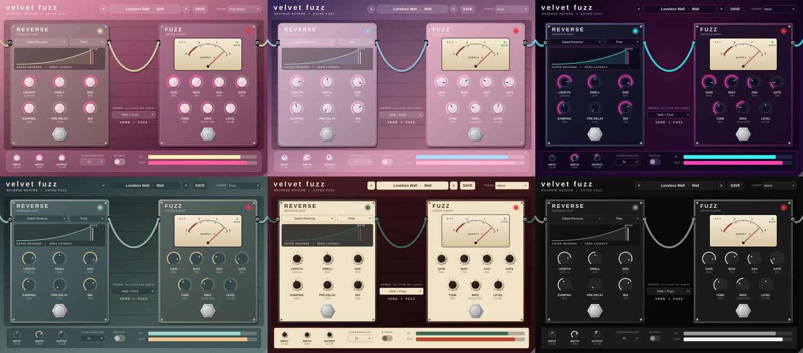

# Velvet Fuzz

A shoegaze "glide guitar" box (VST3 + AU + standalone): a reverse reverb and a starved, sputtering
fuzz, with an order switch (Verb > Fuzz, Fuzz > Verb, Parallel). Two reverse modes: Gated Reverse
(zero latency, playable live) and Tape Reverse (a real reversed tail, latency = Length). 25 presets, six
UI themes. See `docs/DESIGN.md` for the signal flow and DSP.



## Build

CI (`.github/workflows/build.yml`) builds universal macOS (11+) VST3 / AU / standalone and Windows x64
VST3 / standalone, runs the engine tests, and makes a macOS `.pkg` and a Windows `Setup.exe`. Pushing a
`v*` tag publishes both to a GitHub Release.

```
cmake -B build -DCMAKE_BUILD_TYPE=Release            # fetches JUCE 8.0.4
# or: cmake -B build -DJUCE_DIR=/path/to/JUCE
cmake --build build --config Release
ctest --test-dir build                                # engine tests
```

macOS builds target macOS 11+ universal (Intel + Apple Silicon). No AVX2 or other `-march` flags are used;
the DSP is scalar C++. Windows builds use the static runtime.

Layout: `Source/engine` is plain C++ (parameter table, reverse reverbs, fuzz, presets) with tests in `tests/`.
`Source/plugin` is the JUCE wrapper, themes and UI. `tools/Snapshots.cpp` renders the docs screenshots
(`-DVELVETFUZZ_BUILD_SNAPSHOTS=ON`, run under `xvfb-run` on Linux). User presets are saved as `.vfpreset`
files in `~/Library/Application Support/Velvet Fuzz/Presets` (macOS) or `%APPDATA%\Velvet Fuzz\Presets` (Windows).
